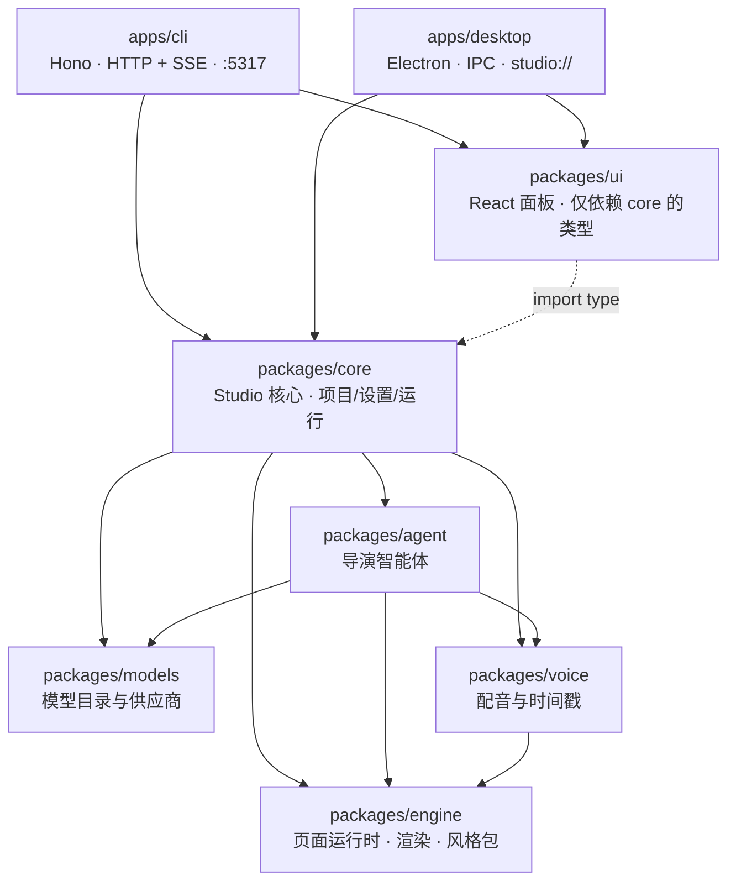
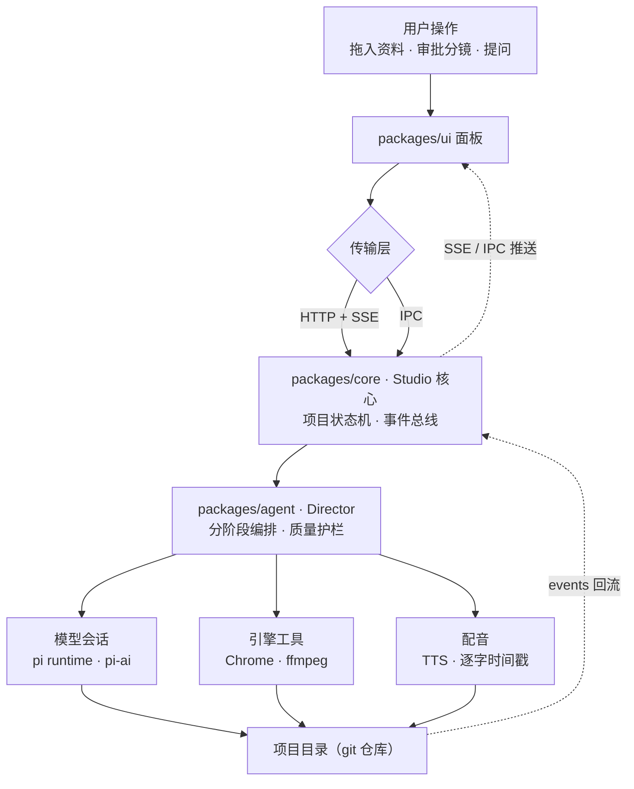
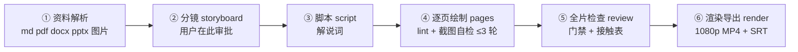

# Frametell 架构图谱

> 本文件梳理**当前代码的实际结构**，与 `docs/ARCHITECTURE.md` 互补。
> 注意：`docs/ARCHITECTURE.md` 描述的是设计意图，其"仓库布局"一节仍写作单个 `apps/studio`，
> 而实际已拆分为 `apps/cli` + `apps/desktop`，并新增了 `packages/core` 与 `packages/ui`。**以本文件为准。**

---

## 1. 组件依赖图（编译期）



**分层与依赖方向**

| 层 | 包 | 角色 |
|---|---|---|
| 宿主层 | `apps/cli`、`apps/desktop` | 只做**传输**：HTTP+SSE 或 IPC。业务逻辑一律不在这里 |
| 应用层 | `packages/core`、`packages/ui` | `core` 持有全部业务逻辑；`ui` 只负责呈现与交互 |
| 能力层 | `packages/agent`、`packages/models`、`packages/voice`、`packages/engine` | 可复用能力，依赖图**无环** |

**三个值得注意的设计**

1. **`packages/ui` 对 `packages/core` 只有类型依赖。**
   源码里全部是 `import type ... from '@frametell/core/types'`。因此浏览器包不会拖入任何 Node 代码，
   传输方式可以在运行时切换（浏览器走 HTTP，Electron 走 IPC）而无需重新打包。

2. **`packages/core` 是唯一的行为定义处。**
   `Studio` 类的每个方法就是一项客户端能力；CLI 与桌面端只是把这些方法翻译成各自的传输协议。
   想加一个功能，应当改 `core`，而不是在两个宿主里各写一遍。

3. **`packages/engine` 与 `packages/models` 是叶子节点**（无内部依赖），可以独立复用与测试。

---

## 2. 运行时数据流



**事件类型**（定义于 `packages/agent/src/events.ts`，共 17 种）

| 事件 | 含义 |
|---|---|
| `stage` | 阶段开始/完成/失败/跳过 |
| `agent` | 某个会话的活动：文本、思考、工具调用、单轮用量 |
| `storyboard_check` | 分镜 lint 的第 N 轮结果与问题清单 |
| `approval` | 分镜已通过检查，等待用户审批 |
| `page` | 某页的状态（queued/drawing/checking/ok/flagged/failed）与问题 |
| `cost` | 本次模型调用的用量与金额，累计到影片总花费 |
| `commit` | 一次 git 提交（agent 每步的改动） |
| `ready` / `done` | 影片已绘制完成 / 已导出 mp4 |
| `gate` | 成片门禁结果（空白帧等） |
| `paused` / `resumed` / `error` / `note` / `user` / `voice` / `narrate` / `render` | 其余生命周期事件 |

**事件如何持久化与回放**：每个事件追加写入项目目录下的 `.studio/events.jsonl`（带 `seq` 序号）。
面板用 `Last-Event-ID` 或 `?since=` 续传，页面刷新后整段对话都能重放。

---

## 3. 生产流水线（Director 的阶段）



每个阶段是**独立的 agent 会话**，上下文短、缓存命中率高，失败只重跑该阶段。

阶段常量定义于 `packages/agent/src/events.ts`：
`research | storyboard | script | narrate | pages | review | render`

**关键点：质量靠工程护栏，不靠模型自觉。**
分镜 lint、页面 lint、接触表截图、成片门禁都由编排器（Director）强制执行，再把结果交给模型去修。
模型不需要"记得去看"，弱模型也能稳定出片。

---

## 4. 项目目录解剖

一个视频 = 一个目录 = 一个 git 仓库。

```
projects/<id>/
├── index.html        引擎入口，加载 script.js 与 boot.js
├── engine →          指向引擎包的链接（不复制文件）
├── engine_modules/   引擎的依赖（链接）
├── script.js         解说词与页面定义（META + PAGES）—— 唯一真相
├── voice.js          真实配音时间轴（逐字）
├── pages/pNN.js      每页画面：时间的纯函数
├── storyboard.json   分镜：页面 + 节拍（beats）
├── audio/            逐页配音，一页一条
├── out/              接触表截图、成片 MP4、SRT 字幕
├── materials/        原始资料 + 研究简报 research.md
├── refs/             用户在对话中附带的文件
├── .studio/          state.json · events.jsonl · project.json · sessions/
└── .git/             agent 每一步 = 一次 commit
```

**为什么值得单独理解这个目录**：

- **版本即审计**。`git log --oneline` 就是 agent 的工作流水（`p05：初稿`、`p05：第 1 轮修改`…），
  `git revert` 就是撤销。调试"它为什么这么画"时这是最直接的证据。
- **产物全在磁盘上**，可以直接用引擎工具单跑调试，无需起整条流水线：

```bash
cd ~/.frametell/projects/<id>
node engine/tools/lint.mjs --only p03              # 版面检查
node engine/tools/snap.mjs --only p03 --sheet a 1.2 2.4   # 截图接触表
node engine/tools/check.mjs --only p03 --sheet a 1.2 2.4   # 检查 + 截图，一次出 JSON
node engine/tools/pages.mjs --json                 # 每页真实时间轴
node engine/tools/render.mjs --fps 30              # 渲染
```

---

## 5. 安全边界

| 边界 | 做法 | 位置 |
|---|---|---|
| 网络暴露 | 只监听 `127.0.0.1`，每次启动随机 token，API 需 token | `apps/cli/src/server.ts` |
| 密钥 | 只存 `~/.frametell/config.json`（0600），日志与事件中一律脱敏 | `packages/core/src/config.ts` |
| agent 写盘 | 只能写在项目目录内；路径逐层打开校验，链接与硬链接均被拒绝 | `packages/agent/src/projectfs.ts` |
| 代码执行 | agent 生成的页面代码只在沙箱 iframe 与无头浏览器中运行 | `packages/engine/tools/*.mjs` |
| shell 隔离 | Linux 下用 bwrap 用户命名空间 + seccomp 过滤；`FRAMETELL_SANDBOX_NONET=1` 可再断网 | `packages/agent/src/tools/sandbox.ts`、`seccomp.ts` |
| 子进程 | ffmpeg 与文档解析器跑在受限子进程，ffmpeg 仅允许本地文件协议 | `packages/core/src` |

---

## 6. 相关文档

| 文件 | 内容 |
|---|---|
| `docs/ARCHITECTURE.md` | 设计意图与总体架构（仓库布局一节已过时） |
| `docs/QUALITY.md` | 质量体系：分镜 lint 规则、页面 lint、门禁、评测方法 |
| `packages/engine/README.md` | 引擎的项目目录与工具命令 |
| `packages/engine/styles/*/GRAMMAR.md` | 各风格的语法卡：能做什么、绝不做什么 |
| `packages/agent/prompts/*.md` | 各阶段的系统提示词 |
| `DESIGN.md` | Ink & Paper 设计系统：令牌、字体、布局、动效 |
| `PRODUCT.md` | 产品定位与设计原则 |
